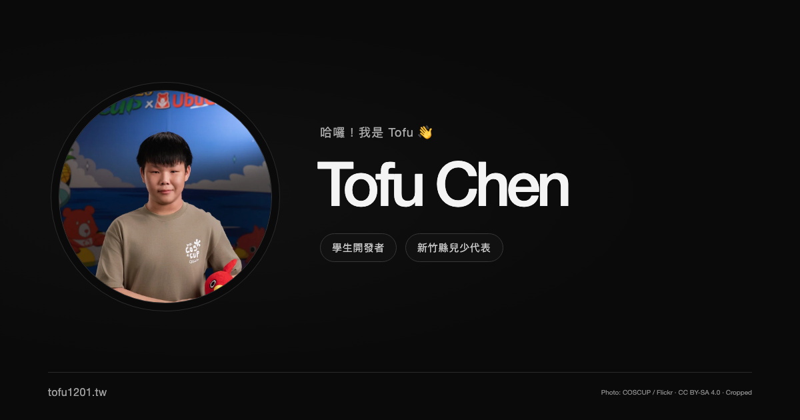

# Tofu Chen · tofu1201.tw

Tofu Chen 的個人網站，介紹學生開發者與新竹縣兒少代表的身分、任職團隊及技術社群參與經歷。

[個人網站](https://tofu1201.tw) · [Cloudflare Pages](https://tofu1201-tw.pages.dev) · [聯繫信箱](mailto:tofu@tofu1201.tw)

[](https://tofu1201.tw)

## 專案特色

- 黑色的一頁式設計，包含首頁、團隊、活動與聯繫。
- 圓形形象照與自介整合於主視覺，支援桌機與手機瀏覽。
- 內容集中管理，直接修改設定檔即可更新個人資料。
- 使用原生 HTML、CSS、JavaScript 與 Node.js，無第三方執行期依賴。
- 建置時產生完整 HTML 與 SEO 資料，關閉 JavaScript 仍可閱讀與導覽。
- 支援鍵盤操作、跳至主要內容、手機選單及減少動態效果偏好。

網站採靜態架構，無後台、資料庫或外部字型請求。

## 本機開發

需要 **Node.js 22 以上**，不需安裝套件。在專案根目錄執行：

```sh
npm run dev
```

開啟 `http://127.0.0.1:4321`。修改內容後重新整理瀏覽器即可看到更新。如需手機在同一個區域網路預覽：

```sh
npm run dev -- --host 0.0.0.0 --port 4321
```

## 修改個人內容

內容集中在 `src/data/profile.mjs`：

- `labels`：主視覺的兩個身分標籤。
- `greeting`：姓名上方的開場招呼。
- `summary`：搜尋與社群分享摘要。
- `introduction`：簡介；以 `\n\n` 分成多段。
- `portrait.src`：目前為 `/images/avatar.webp`。替換時將圖片放到 `public/images/`，再填入對應路徑；頭像顯示為圓形，留白時使用 TC 姓名縮寫。
- `portrait.alt`：照片替代文字。
- `portrait.position`：裁切焦點，例如 `50% 35%`，對應 CSS `object-position`。
- `portrait.credit`：照片名稱、作者、來源與授權；填寫時會在頁尾顯示署名。替換照片時，請同步更新或移除不適用的來源資訊。
- `skills`：技術資料，用於 SEO 結構化資料與公開個人資料。
- `teams`：團隊名稱、`role` 職稱、`logo` 路徑及選填的 `url`。Logo 放在 `public/images/`；尚未提供時顯示 `initials`。
- `activities`：活動名稱、`roleLabel` 參與身分、Logo 與官方網址。
- `socials`：Discord、Instagram、Mail 與 LinkedIn 連結。
- `contact.website`：正式網域，目前為 `https://tofu1201.tw`。

範例：

```js
portrait: {
  src: '/images/portrait.webp',
  alt: 'Tofu Chen 形象照',
  position: '50% 35%',
},
```

`logoTheme: 'dark'` 使用深色底，`'light'` 使用淺色底；可依原始 Logo 的顏色選擇。活動圖像來自官方網站，部分使用官方品牌圖示，詳細來源與年份核對記錄在 `public/images/activities/SOURCES.md`。

團隊區塊包含 Hyper Group Network Ltd. 與班利小舖；社群聯繫提供 Discord、Instagram、Mail 與 LinkedIn。圖片均隨專案保存，瀏覽網站時不需向原始圖片平台請求。

## 正式建置

```sh
npm run build
npm run preview -- --port 4322
```

正式檔案輸出至 `dist/`，預覽網址為 `http://127.0.0.1:4322`。建置會重新產生整個輸出目錄，請修改 `src/` 或 `public/` 中的來源檔案。

## 部署

使用 **Cloudflare Pages**，連接 GitHub 儲存庫 [`tofu1201/tofu1201.tw`](https://github.com/tofu1201/tofu1201.tw)。正式部署設定如下：

| 設定 | 值 |
| --- | --- |
| Pages 專案名稱 | `tofu1201-tw` |
| Pages 網址 | https://tofu1201-tw.pages.dev |
| 正式分支 | `main` |
| 框架預設 | None |
| 根目錄 | 儲存庫根目錄 |
| Node.js 版本 | 22，由 `.node-version` 指定 |
| 建置指令 | `npm run build` |
| 輸出目錄 | `dist` |
| 環境變數 | 不需要 |

在 Cloudflare 控制台的 **Workers & Pages → Create application → Pages → Connect to Git** 選擇這個儲存庫，套用上表設定即可建立專案。私人儲存庫需要授權 Cloudflare 的 GitHub App 存取。

啟用 Git 整合後，推送至 `main` 會自動建置並更新正式網站，其他分支則產生預覽部署；建置結果可在 Cloudflare 專案的 Deployments 查看。

若需要從本機手動部署，專案已提供 `wrangler.jsonc`：

```sh
npx --yes wrangler@4.152.0 login
npm run build
npx --yes wrangler@4.152.0 pages deploy dist --project-name tofu1201-tw --branch main
```

`dist/` 與 Wrangler 本機狀態已加入 `.gitignore`，不會提交至版本庫。本機預覽伺服器僅供開發與驗證使用。

正式網域設定於 `src/data/profile.mjs` 的 `contact.website`，目前為 `https://tofu1201.tw`。綁定網域時，請在 Pages 專案的 **Custom domains** 新增網域，依控制台指示設定 DNS，並等待 HTTPS 憑證生效。使用其他正式網域時，請先修改 `contact.website`，再重新建置，以更新 canonical、分享圖片網址與 sitemap。

## SEO 與社群分享

頁面已設定繁體中文語系、標題、描述、canonical、Open Graph、Twitter Card，以及相互連結的 `Person`、`ProfilePage`、`WebSite` JSON-LD。姓名、身分、簡介、團隊、技能與活動內容直接輸出為 HTML，無須 JavaScript 才能讀取。

建置同時產生 `robots.txt`、`sitemap.xml`、`profile.json`、`llms.txt`。部署後可將 `https://tofu1201.tw/sitemap.xml` 提交至 Google Search Console。更換網域時，修改 `contact.website` 後重新建置。

黑色分享圖 `public/og-image.png`（1200 × 630）及 Apple 圖示已提供。修改姓名或身分標籤後，可在安裝 Chrome 的電腦執行下列指令重新產生；必要時以 `CHROME_PATH` 指定 Chrome/Chromium 執行檔：

```sh
npm run assets
npm run build
```

## 專案結構

```text
.node-version           Cloudflare 建置使用的 Node.js 版本
wrangler.jsonc          Cloudflare Pages 專案與輸出目錄設定
src/
  data/profile.mjs       個人資料、團隊、活動與社群連結
  components/icons.mjs  SVG 圖示
  page.mjs              頁面結構與 JSON-LD
  metadata.mjs          robots、sitemap 與公開個人資料
  not-found.mjs         404 頁面
public/
  assets/               網站樣式與互動程式
  images/               形象照、Logo 與來源紀錄
  og-image.png          社群分享預覽圖
scripts/
  dev.mjs               開發模式
  build.mjs             靜態網站建置
  serve.mjs             本機預覽伺服器
  generate-social.mjs   分享圖與 Apple 圖示產生器
```

## 圖片來源與授權

形象照：[“_KA98892”](https://www.flickr.com/photos/coscup/55451327852/in/album-72177720335045157) by [COSCUP](https://www.flickr.com/photos/coscup/)，採用 [CC BY-SA 4.0](https://creativecommons.org/licenses/by-sa/4.0/) 授權。網站使用的版本已裁切、縮小並轉為 WebP；相關圖像衍生檔案沿用相同授權，署名保留於頁尾。

- [形象照來源與調整紀錄](public/images/PORTRAIT-SOURCE.md)
- [團隊 Logo 來源](public/images/teams/SOURCES.md)
- [活動圖像來源與年份核對紀錄](public/images/activities/SOURCES.md)

團隊與活動名稱、Logo 及商標的權利歸各權利人所有。照片授權適用於該照片及其衍生圖像，不代表網站程式碼或其他素材採用相同授權。
