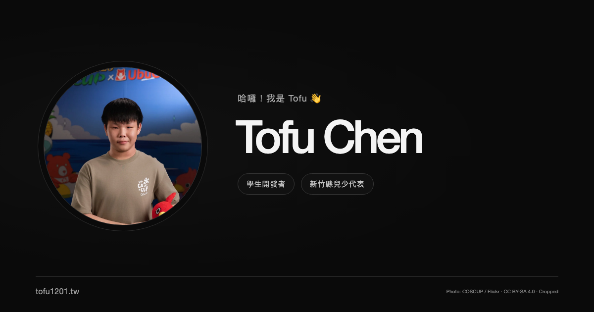

# Tofu Chen · tofu1201.tw

以原生 HTML、CSS、JavaScript 與 Node.js 建置的靜態個人網站，採用黑色視覺、玻璃導覽列與粒子背景，呈現 Tofu Chen 的個人簡介、任職團隊及社群參與經歷。程式碼以 MIT 授權公開，可作為個人網站的開發參考。

[網站](https://tofu1201.tw) · [開發指南](AI_PROJECT_GUIDE.md) · [SEO 與 AEO](docs/SEARCH.md) · [問題回報](https://github.com/tofu1201/tofu1201.tw/issues) · [MIT License](LICENSE)

[](https://tofu1201.tw)

## 特色

- 一頁式主站，包含個人簡介、團隊、活動、友站與聯繫，另提供資訊課自主學習計畫頁。
- 響應式版面、鍵盤導覽、圖片載入備援與可暫停的背景動畫，支援減少動態效果偏好。
- 個人內容集中管理，HTML、結構化資料、Markdown 與 JSON 在建置時同步產生。
- 完整靜態 HTML，關閉 JavaScript 仍可閱讀與導覽；無外部字型、資料庫或第三方執行期依賴。
- 支援 Cloudflare Pages，也可將建置結果部署至支援靜態檔案的網站服務。

## 快速開始

需要 **Node.js 22 以上**。專案不需安裝第三方套件。

```sh
git clone https://github.com/tofu1201/tofu1201.tw.git
cd tofu1201.tw
npm run dev
```

開發網址為 `http://127.0.0.1:4321`。如需在同一區域網路的其他裝置預覽：

```sh
npm run dev -- --host 0.0.0.0 --port 4321
```

## 內容設定

主要資料位於 [`src/data/profile.mjs`](src/data/profile.mjs)。

| 欄位 | 用途 |
| --- | --- |
| `name`、`nickname`、`labels` | 姓名、暱稱與身分 |
| `greeting`、`introduction` | 開場招呼與自介；自介以空白行分段 |
| `summary` | 搜尋摘要、分享描述與結構化個人簡介 |
| `portrait` | 形象照路徑、替代文字、裁切焦點及作者授權 |
| `skills` | 程式語言、網頁技術與技術興趣 |
| `teams`、`activities`、`friends` | 名稱、職稱或參與身分、圖像及網站連結 |
| `socials`、`email` | 公開聯繫方式 |
| `contact.website` | 正式網站網址，用於產生 canonical、sitemap 與資料連結 |

圖像放在 `public/images/`，資料中的路徑以 `/images/` 開頭。`logoTheme` 可設為 `dark` 或 `light`；未設定圖像時使用 `initials`。替換形象照時，應一併更新 `portrait.alt`、`portrait.credit` 與素材來源文件。

學習計畫的內容與樣式位於 [`public/self.html`](public/self.html)，建置時會補上共用的搜尋與分享資料，網址為 `/self`。

## 建置與測試

```sh
npm test
npm run build
npm run preview -- --port 4322
```

正式檔案輸出至 `dist/`，預覽網址為 `http://127.0.0.1:4322`。建置會重建輸出目錄，內容應修改於 `src/` 或 `public/`。

修改姓名、身分或形象照後，可用本機 Chrome／Chromium 重新產生分享圖與 Apple 圖示：

```sh
npm run assets
npm run build
```

必要時以 `CHROME_PATH` 指定瀏覽器執行檔。一般開發與建置可直接使用版本庫內的圖像。

## 部署

Cloudflare Pages 設定：

| 項目 | 設定 |
| --- | --- |
| 框架 | None |
| 建置指令 | `npm run build` |
| 輸出目錄 | `dist` |
| Node.js | 22，由 `.node-version` 指定 |
| 環境變數 | 無必要設定 |

啟用 Git 整合後，正式分支的新提交會觸發部署。從本機部署可使用 Wrangler：

```sh
npx wrangler@4 pages deploy dist --project-name your-project-name
```

Fork 後應更新 `contact.website` 與 `wrangler.jsonc` 的專案名稱。預設以網域根目錄部署；其他靜態服務需設定 `/self` 對應 `self.html`，並套用輸出的 `_headers` 中之 Markdown MIME 與 canonical 標頭。

## 搜尋與資料存取

兩個頁面都有獨立的標題、描述、canonical、Open Graph 與 Twitter Card。主站以 `Person`、`ProfilePage`、`OrganizationRole` 和 `ItemList` 描述人物、團隊職稱與活動參與資料。

建置另產生 `robots.txt`、`sitemap.xml`、`profile.md`、`profile.json` 與 `llms.txt`。這些資料與頁面共用內容來源，便於搜尋引擎、閱讀工具及答案服務讀取。設定原則與驗證方式見 [SEO 與 AEO](docs/SEARCH.md)。

## 參與開發

歡迎以 Issue 回報問題或提出改善建議，並透過 Pull Request 提交修改。提交內容應說明改善目的、影響範圍及驗證結果；涉及介面時附上桌面與手機預覽。程式結構與維護方式見 [開發指南](AI_PROJECT_GUIDE.md)。

## 授權與圖像來源

原創程式碼與文件採用 [MIT License](LICENSE)。形象照及含該照片的衍生分享圖適用 [CC BY-SA 4.0](https://creativecommons.org/licenses/by-sa/4.0/)；第三方名稱、Logo、商標與頭像保留各權利人的權利，屬於 MIT 授權範圍以外的素材。

形象照 [“_KA98892”](https://www.flickr.com/photos/coscup/55451327852/in/album-72177720335045157) 由 [COSCUP](https://www.flickr.com/photos/coscup/) 發布，網站版本經裁切、縮小及 WebP 轉檔。

- [形象照來源與授權](public/images/PORTRAIT-SOURCE.md)
- [團隊圖像來源](public/images/teams/SOURCES.md)
- [活動圖像來源](public/images/activities/SOURCES.md)
- [友站圖像來源](public/images/friends/SOURCES.md)
